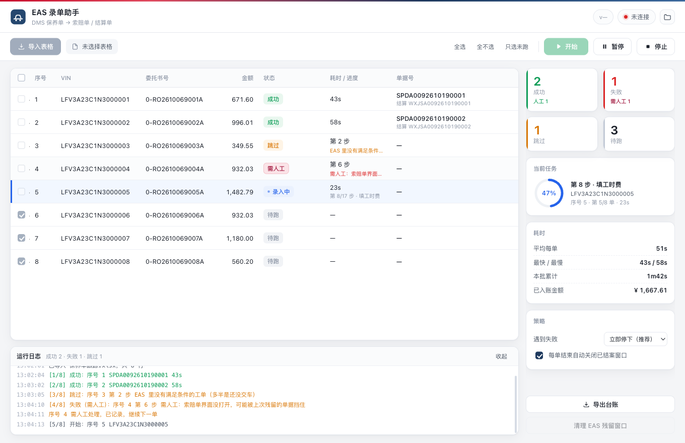
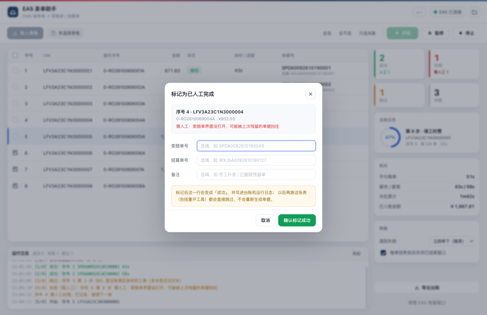
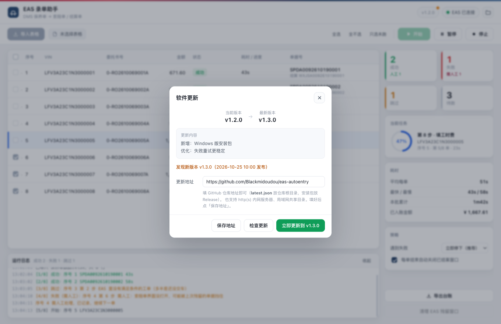

# EAS 录单助手

把 DMS 导出的维修表格，批量录入金蝶 EAS —— 按委托书前缀自动识别业务（保养 / 索赔 / 市场处置），从「维修工单」一路跑到「索赔单 + 维修结算单」，一单约 60 秒，跑完自动出成功/失败台账。

> 内部效率工具。仓库里只有程序与发布信息，**不包含任何客户数据、VIN 或公司内部配置**。



---

## 这个工具解决什么

4S 店每台车做一次厂家付费保养，都要在 EAS 里手工建两张单：

1. 按 VIN 查工单 → 筛选 → 生成索赔单 → 填申请号/工时费/材料费 → 金额调整 → 提交 → 结案
2. 推式生成结算单 → 选结算户 → 提交 → 审核

一单 16 步点击，几十张单一整天。这个工具把这套流程交给程序执行，人只需要：导表 → 点开始 → 处理跑完剩下的异常单。

## 功能

- **批量跑单**：一张 DMS 导出的 `保养单跟踪.xlsx`，勾选要跑的行，剩下的自动完成
- **业务自动识别**：按委托书前缀自动路由——`0-` 保养单、`1-` 索赔单、`Z-` 市场处置单，导入后不用手动选
- **进度可见**：每行实时显示「第几步 / 步骤名 / 已用秒数」，当前正在跑的行高亮并自动滚动跟随；右侧面板显示平均耗时、最快最慢、本批累计、已入账金额
- **失败分类**：第 1~4 步失败（通常是未交车）自动跳过不生成单据；VIN 查询重试 3 次（5 秒一次）都无结果直接标「EAS未查询到工单」跳过，不干等；中途残留单据导致的失败直接标「需人工」，继续跑下一单，不卡整批
- **录完自动关窗**：每单跑完自动关闭本单的索赔单/结算单窗口，收尾兜底清残留，EAS 不会越积越多窗口
- **人工完成标记**：异常单在 EAS 里手工处理完，点一下「标记完成」即记为成功，今后不再重跑
- **台账导出**：一键导出 txt，含成功/失败明细、耗时、人工处理提示；每次运行也自动留档
- **自动更新**：软件内检查更新 → 下载 → 自动替换重启，不用再手动装

| 标记人工完成 | 软件更新 |
|---|---|
|  |  |

## 系统要求

| | macOS | Windows |
|---|---|---|
| 系统 | macOS 11+（Intel / Apple Silicon） | Windows 10 / 11（64 位） |
| 依赖 | 无需安装任何运行环境 | 无需安装任何运行环境 |
| EAS | 金蝶 EAS 8.5 客户端，**JDK 1.6 和 JDK 1.8 都兼容** | 同左 |
| 路径 | — | EAS 装在带空格的路径（如 `C:\Program Files`）也能正常注入 |

两个平台的安装包功能完全一致，探针均为纯 Java 6 字节码，新旧 EAS 客户端都能加载。

## 下载安装

> **先说明一件事**：仓库首页绿色 `Code` → `Download ZIP` 下到的是**源码**（只有 README、
> CHANGELOG 这些），不是软件。软件请到右侧 **Releases** 里下，文件名带 `macos` / `windows`。

### macOS

1. 到 [Releases](../../releases/latest) 下载 `EAS-AutoEntry-最新版本-macos.zip`
2. 解压出 `EAS录单助手.app`，拖到「应用程序」
3. **首次打开**：右键点图标 → 打开 → 再点「打开」（未做苹果公证，只需一次）
4. 首次使用要先给 EAS 装上探针，见下文「首次配置」

### Windows

1. 到 [Releases](../../releases/latest) 下载 `EAS-AutoEntry-最新版本-windows.zip`
2. 解压到任意目录（建议 `D:\EAS-AutoEntry`，路径别带空格和中文）
3. 双击 `EAS-AutoEntry.exe` 即可，**免安装**，和 macOS 用法完全一样
4. 如果弹出「Windows 已保护你的电脑」：点「更多信息」→「仍要运行」（未做代码签名，只需一次）
5. 同一目录里的 `_internal` 文件夹不能删、不能拆开，程序靠它启动
6. 首次运行会自动装探针；EAS 装在 `C:\Program Files` 时，右键 exe →「以管理员身份运行」


## 首次配置（探针注入）

**现在不用手工装探针了**：第一次打开工具，它会自己检查并装好。

1. 先装好金蝶 EAS 客户端（macOS 默认 `/Applications/EASClient.app`；
   Windows 默认 `C:\Program Files\EASClient`）
2. 打开「EAS 录单助手」，它会自动做三件事：铺 `easprobe.jar`、铺 `cmdrunner.jar`、
   把 `-javaagent` 写进 EAS 的启动配置。已经装过的步骤自动跳过
3. 如果界面上出现橙色提示「探针已装好，只差重启 EAS」，就**完全退出 EAS**
   （macOS 用 ⌘Q，Windows 从托盘/任务管理器确认 javaw.exe 已退出，不能只关窗口）
   再重新打开；右上角圆点变绿即成功

> 工具改动的只有 EAS 的 `set-client-env.sh`（Windows 为 `set-client-env.bat`），
> 在末尾追加一段带 `EAS-PROBE INJECT` 标记的块，这个文件在 EAS 更新器的豁免名单里，
> 客户端升级不会冲掉。原始文件已备份到探针目录（`set-client-env.sh.orig`），
> 想恢复把那段删掉即可。
>
> Windows 上 EAS 装在 `C:\Program Files` 时需要管理员权限：右键「以管理员身份运行」工具，
> 或在探针目录里手动跑一次 `install-windows.bat`。

## 第一次使用，按这个顺序来

1. **装金蝶 EAS 客户端**并确认能正常登录（工具不装 EAS，也不改 EAS 本体）
2. **装本工具**：见上文「下载安装」（macOS 解压拖应用程序；Windows 解压免安装）
3. **打开工具**：它会自动给 EAS 装探针（铺 jar + 写启动配置），首次使用不用手工装任何东西
4. **完全退出并重启 EAS**：看到「探针已装好，只差重启 EAS」的橙色提示时，彻底退出 EAS（macOS ⌘Q；Windows 确认任务管理器里 javaw.exe 已退出，不能只关窗口）再打开
5. **看右上角圆点**：变绿 = 探针生效，可以开始跑单
6. **登录 EAS**，打开「维修工单」列表界面，按下一条「跑单前检查」核对状态
7. **导入表格、开始**：见下文「日常使用」

## 跑单前，EAS 应处于什么状态

点「开始」之前，逐条核对：

- ✅ **已登录** EAS 客户端（会话是活的，右上角圆点绿色）
- ✅ **已打开「维修工单」列表界面**——工具从查询这张列表开始，别的界面不行
- ✅ **EAS 上没有挂着任何弹窗**：登录提示、报错框（如 errorCode:500）、掉线重连框都要先手动点掉，否则查询拿不到数据，整批会以「EAS未查询到工单」逐单失败
- ✅ **不要在 EAS 里做别的操作**：跑单期间人不要动 EAS 的鼠标键盘，也不要最小化到别的单据界面
- ⚠️ **掉线了要手动点「重连」**：长时间不操作 EAS 会掉线，工具不会自动重连（当前版本），看到掉线弹窗手动点掉后重新点「开始」继续

## 日常使用

1. 从 DMS 导出保养单跟踪表（xlsx）
2. 点「导入表格」，工具会自动识别**已经录过**的单（灰色不勾选）和**失败的单**（默认勾上可重跑）
3. 勾选要跑的行 → 点「开始」
4. 想停就点「暂停」（当前这单跑完再停，不会在 EAS 里留半截单据）
5. 跑完点「导出台账」

**关于失败**：

- 「跳过」= EAS 里没找到符合条件的工单，最常见是**还没交车**。去 EAS 交车后重新勾选再跑
- 「需人工」= EAS 里有上次做到一半的残留单据，会提示不能重复生成。趁一批跑完，去 EAS 把残留单提交或删除，然后重跑（或手工做完后点「标记完成」）

## 软件更新

工具自带更新器：

1. 点右上角版本号 →「检查更新」
2. 有新版会显示版本号、发布时间和更新内容 →「立即更新」
3. 自动下载 → 校验 sha256 → 等程序退出 → 替换 → 重启成新版

也可以到 [Releases](../../releases/latest) 手动下载覆盖安装。

更新源支持 GitHub 仓库、内网 http 服务器、局域网共享盘。走 GitHub 时会自动在官方源不通时切换到国内镜像。

GitHub 直连打不开时，两种办法任选：

1. **更新弹窗里点镜像按钮**（jsDelivr / ghfast.top / gh-proxy.com / ghproxy.net），点一下自动换源并重新检查；
2. 或把镜像地址粘进「更新地址」→「保存地址」，程序会优先走你填的镜像，例如：
   `https://cdn.jsdelivr.net/gh/Blackmidoudou/eas-autoentry@main/`

## 发布新版本（维护者）

```bash
# 1. 改 core.py 里的 APP_VERSION
# 2. 打包
./build_macos.sh

# 3. 生成更新包与清单（file 写成 Release 下载地址）
python3 tools/make_release.py --platform macos --github Blackmidoudou/eas-autoentry \
        --notes "本次更新内容"

# 4. 一键发布：建 tag、传包、更新 latest.json 并推送
./tools/publish_github.sh
```

`latest.json` 是客户端读的版本清单，放在仓库根目录；安装包放 Release。两处都更新后，所有客户端点「检查更新」就能看到。

## 常见问题

**Q：提示「探针未安装 / 未注入」**
按「首次配置」重装探针，并且要**完全退出** EAS 后重新启动。

**Q：一单卡住不动**
EAS 里有弹窗挡着（登录提示、报错框、确认框），处理掉就会继续。

**Q：更新下载很慢或失败**
工具会自动切换镜像。如果全部失败，可以在更新面板把地址改成公司内网服务器上的同一份 `latest.json` 目录。

**Q：成功过的单会不会被重跑？**
不会。成功行勾选框锁定，后端也会再过滤一次，双重保险。

**Q：数据存在哪？**
都在本机 `~/eas-probe`（Windows 为 `%LOCALAPPDATA%\eas-probe`），不上传任何地方。

## 版本历史

见 [CHANGELOG.md](CHANGELOG.md)。
